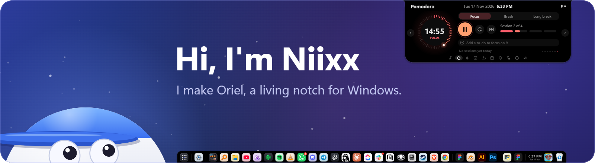

  

I build small, friendly desktop apps for Windows. Right now that's **Oriel**.

## 🦆 Oriel

A notch that lives at the top of your screen. Hover it and it opens: your music and its lyrics, a focus timer, to-dos, water reminders, your calendar, notifications and quick controls. Version 1.1 adds a dock, a Launchpad and eight themes.

  

  <a href="https://github.com/Niix-x/Oriel-Releases/releases/latest"><b>Download Oriel</b></a> ·
  <a href="https://github.com/Niix-x/Oriel-Releases">See it in action</a> ·
  <a href="https://github.com/Niix-x/Oriel-Releases/discussions">Join the discussions</a>

Free for Windows 10 and 11. Ideas, bug reports and screenshots of your setup are always welcome.
